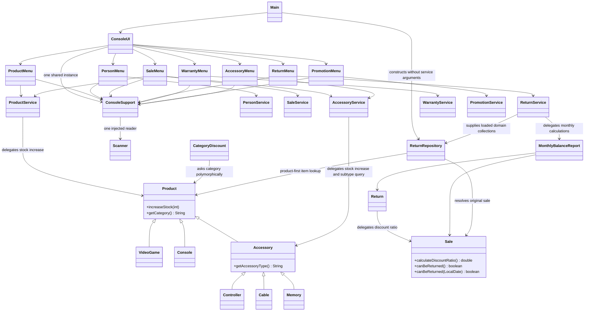

# R7 design after corrections

Source: feature/grasp-refactor at 5af8633 plus the ConsoleUI/CategoryDiscount integration diff
recorded with source hashes in evidence/r7/integration-20261023-083510.
The implementation commit will be assigned when this integration is published.
Focused dependency diagram for the eight consolidated findings; 52 production
Java classes exist. The diagram omits unchanged details and is not a full UML
attribute inventory. Compare with grasp-before.md at baseline b416df2.

V-01: stock arithmetic belongs to Product. V-02: Sale owns ratio interpretation.
V-03/V-06: category and accessory subtype remain separate polymorphic queries.
V-04: explicit date overload and named 30-day window preserve the no-arg API.
V-05: repository receives domain data and has no service imports or fields.
V-07: MonthlyBalanceReport calculates; ReturnService preserves compatibility.
V-08: seven collaborators own module interaction; ConsoleUI coordinates main
navigation, and one helper shares parsing/error presentation and the scanner.

This records implemented responsibility changes, not independent peer approval.