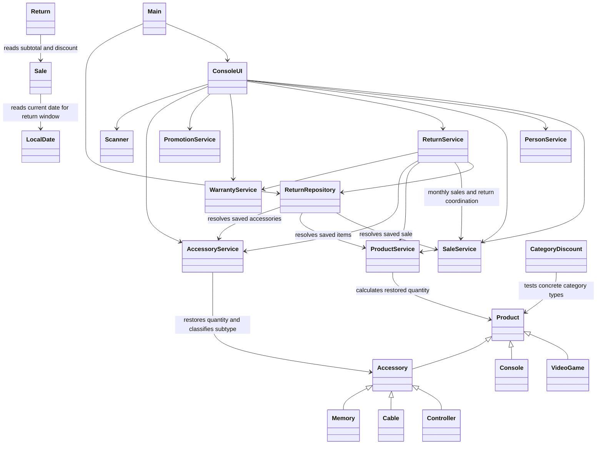

# R7 design before corrections

Source: b416df2. Focused dependency diagram for V-01 through V-08;
this is not a complete class/attribute inventory. Arrows describe current
collaboration, not the proposed design. Created before Java corrections.

Evidence: Main constructors; ConsoleUI fields and menu methods;
ProductService.restoreStock; AccessoryService.restoreStock/typeOf;
Return.discountRatio; CategoryDiscount.matchesTargetCategory;
Sale.canBeReturned; ReturnService monthly methods; ReturnRepository fields.

The after diagram must describe the implemented revision, not merely this plan.