# Exception and Validation Class Diagram - Requirement 6

ConsoleUI implements the ConsoleMenu responsibility described in
Requirement 6. The diagram describes the intended exception and
validation design.

```mermaid
classDiagram
    class RuntimeException

    class GameZoneException {
        <<abstract>>
        -String errorCode
        +GameZoneException(message)
        +GameZoneException(message, errorCode)
        +getErrorCode() String
    }

    class ResourceNotFoundException {
        +ResourceNotFoundException(resourceType, resourceId)
    }

    class BusinessRuleException {
        +BusinessRuleException(message)
    }

    class InvalidDataException {
        +InvalidDataException(fieldName, problem)
    }

    class PersistenceException {
        +PersistenceException(message, cause)
    }

    RuntimeException <|-- GameZoneException
    GameZoneException <|-- ResourceNotFoundException
    GameZoneException <|-- BusinessRuleException
    GameZoneException <|-- InvalidDataException
    GameZoneException <|-- PersistenceException

    class ProductValidator {
        +validateProductData(String id, String title, double price, int stock)$
        +validateStockAvailability(Product product, int requestedQuantity)$
        +validateProductExists(Product product, String productId)$
    }

    class PersonValidator {
        +validatePersonData(String id, String name, String email, String phone)$
        +validatePersonExists(Person person, String personId)$
        +validateUniquePerson(List~Person~ existing, String newId)$
    }

    class SaleValidator {
        +validateSaleData(Customer customer, Seller seller, List~Product~ products)$
        +validateSaleExists(Sale sale, String saleId)$
    }

    class Product
    class Person
    class Customer
    class Seller
    class Sale

    Person <|-- Customer
    Person <|-- Seller

    ProductValidator ..> Product : inspects
    PersonValidator ..> Person : inspects
    SaleValidator ..> Customer : inspects
    SaleValidator ..> Seller : inspects
    SaleValidator ..> Product : inspects
    SaleValidator ..> Sale : inspects

    class ProductService
    class PersonService
    class SaleService

    ProductService ..> ProductValidator : validates
    PersonService ..> PersonValidator : validates
    SaleService ..> SaleValidator : validates
    SaleService ..> ProductValidator : checks stock

    class ProductRepository
    class PersonRepository
    class SaleRepository

    ProductService --> ProductRepository : loads and saves
    PersonService --> PersonRepository : loads and saves
    SaleService --> SaleRepository : loads and saves

    ProductValidator ..> InvalidDataException : throws
    ProductValidator ..> BusinessRuleException : throws
    ProductValidator ..> ResourceNotFoundException : throws

    PersonValidator ..> InvalidDataException : throws
    PersonValidator ..> BusinessRuleException : throws
    PersonValidator ..> ResourceNotFoundException : throws

    SaleValidator ..> InvalidDataException : throws
    SaleValidator ..> BusinessRuleException : throws
    SaleValidator ..> ResourceNotFoundException : throws

    ProductRepository ..> PersistenceException : throws
    PersonRepository ..> PersistenceException : throws
    SaleRepository ..> PersistenceException : throws

    class ConsoleUI {
        +start()
    }

    class Main {
        +main(String[] args)$
    }

    Main --> ConsoleUI : creates and starts

    ConsoleUI --> ProductService : invokes
    ConsoleUI --> PersonService : invokes
    ConsoleUI --> SaleService : invokes

    ConsoleUI ..> ResourceNotFoundException : catches
    ConsoleUI ..> BusinessRuleException : catches
    ConsoleUI ..> InvalidDataException : catches
    ConsoleUI ..> PersistenceException : catches

    Main ..> PersistenceException : handles startup failures
```

## Layer responsibilities

- Exceptions are transversal and can be used by all application layers.
- Services invoke validators before changing application state.
- Validators inspect supplied values and model objects.
- Validators do not invoke services or repositories.
- Validators do not read or write files.
- Repositories wrap storage failures and preserve their original cause.
- ConsoleUI presents differentiated Spanish messages.
- Main protects initial data loading.

## Diagram conventions

- Solid inheritance arrows represent superclass relationships.
- Dependency arrows represent usage, validation or exception handling.
- The dollar suffix identifies static methods.
- List types are simplified for readability; implementation signatures
  may use bounded wildcards such as List<? extends Person>.

## Integration status

The diagram represents the target design. Its relationships must be
checked against the final integrated code before delivery.